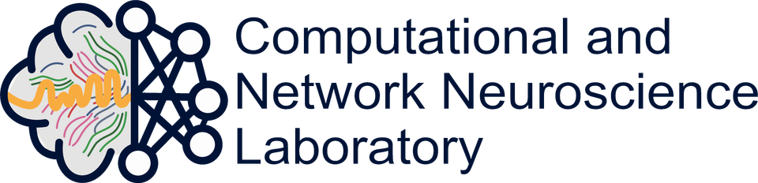
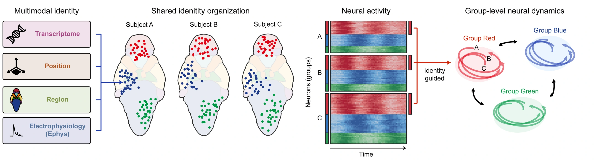
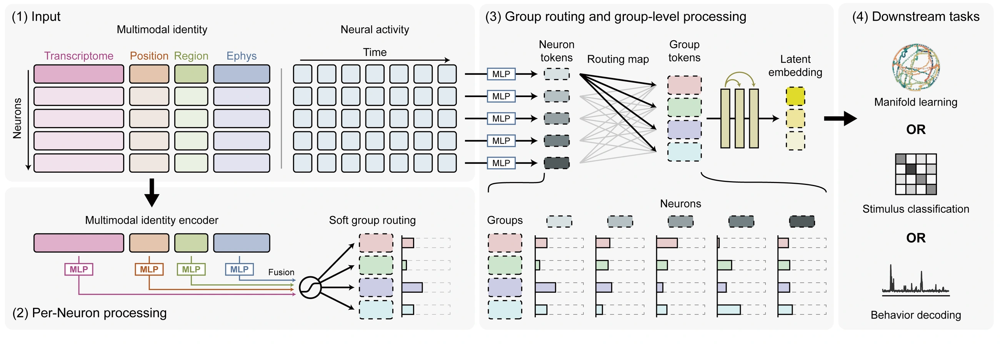
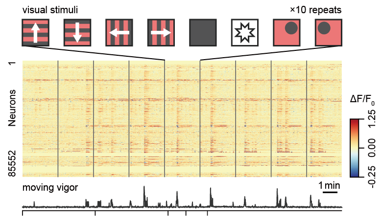
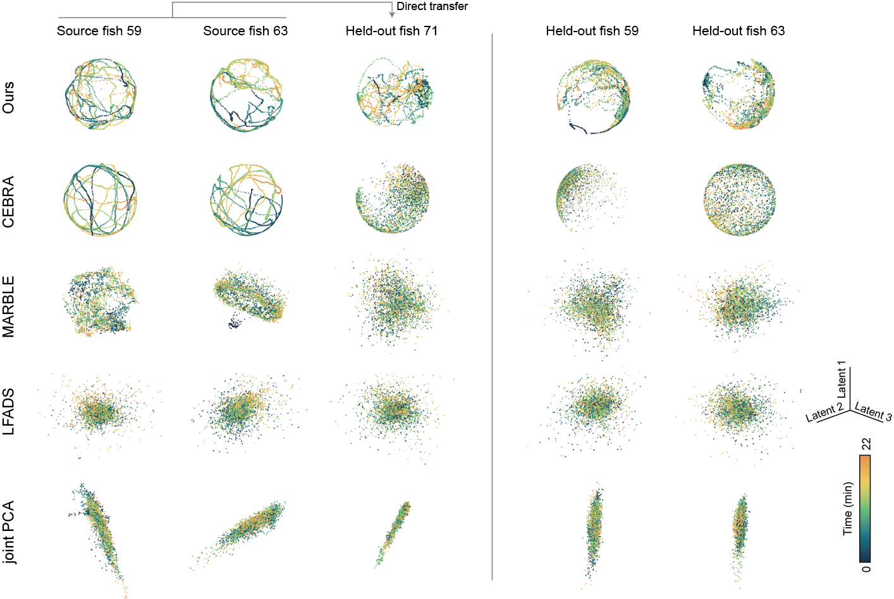

<p align="center">
  <picture>
    <source media="(prefers-color-scheme: dark)" srcset="docs/assets/project-logo-dark.svg">
    
  </picture>
  &nbsp;&nbsp;&nbsp;
  <a href="https://neurips.cc/virtual/2026/loc/sydney/poster/155788"><picture>
    <source media="(prefers-color-scheme: dark)" srcset="docs/assets/neurips-wordmark-dark.svg">
    
  </picture></a>
</p>

<h1 align="center">Neuronal Identity as an Organizational Basis for Analyzing Neural Population Dynamics</h1>

<p align="center">
  Seungjae&nbsp;Han<sup><b>*</b></sup> &nbsp; Joshua&nbsp;Yedam&nbsp;You<sup><b>*</b></sup> &nbsp; Soi&nbsp;Kim<sup><b>*</b></sup> &nbsp; Minho&nbsp;Eom &nbsp; Jinho&nbsp;Park &nbsp; Seunghee&nbsp;Park<br>
  Byeongwook&nbsp;Lee<sup><b>†</b></sup> &nbsp; Young-Gyu&nbsp;Yoon<sup><b>†</b></sup>
</p>

<p align="center"><sup><b>*</b></sup> Equal contribution &nbsp; <sup><b>†</b></sup> Corresponding authors</p>

<p align="center">
  <a href="https://www.kaist.ac.kr/en/"></a>
  &nbsp;&nbsp;
  <a href="https://nica.kaist.ac.kr/"></a>
  &nbsp;&nbsp;
  <a href="https://cnnl.kaist.ac.kr/"><picture>
    <source media="(prefers-color-scheme: dark)" srcset="docs/assets/cnnl-lab-dark.svg">
    
  </picture></a>
</p>

<p align="center">
  <a href="https://nicalab.github.io/identity-group-routing/"><b>Project page</b></a>
  &nbsp;·&nbsp; <a href="https://arxiv.org/abs/2610.36745">arXiv</a>
  &nbsp;·&nbsp; <a href="https://neurips.cc/virtual/2026/loc/sydney/poster/155788">NeurIPS 2026</a>
</p>



**Overview.** Multimodal biological features organize neurons into corresponding groups across subjects, providing a shared basis for analyzing neural population dynamics.

## Abstract

Individual neurons exhibit diverse molecular, morphological, and electrophysiological properties that shape their distinct roles in neural circuits. While these multimodal features are largely shared across individuals, they remain an underutilized source of information in analyzing neural population dynamics. We posit that these shared biological profiles provide a common reference for relating neural dynamics across subjects and recording sessions. Our framework leverages this structure by routing neurons into latent groups based on their biological profiles and analyzing population dynamics through group-level representations. Because these assignments are anchored in biological properties that are consistent across subjects, the learned organization supports transfer to unseen animals without retraining or neuron-wise correspondence. We evaluate our framework on whole-brain calcium imaging in larval zebrafish and large-scale electrophysiology in the mouse visual cortex. Across both species and recording modalities, the framework delivers state-of-the-art performance in both neural decoding and manifold analysis: it achieves superior decoding of behavior and stimulus labels while better preserving the temporal consistency and local geometric structure of latent trajectories on unseen data. Our experiments demonstrate that not only does providing biological features improve baseline performance, but our proposed framework achieves even stronger results by using these properties to explicitly structure the population rather than treating them as auxiliary inputs. Together, these results suggest that organizing neural populations by their multimodal biological features offers a promising framework for generalizing population dynamics across subjects and recording sessions.

## Identity-guided routing

Each neuron’s biological features determine its soft membership in latent groups. A shared activity encoder represents each neuron’s activity window, and routing-weighted aggregation produces group-level representations. A group interaction module maps these representations to a population embedding for neural decoding or manifold learning. The construction is invariant to neuron order.



**Identity-guided routing framework.** Manifold learning, stimulus classification, and behavior decoding are evaluated as separate downstream objectives.

## Identity-guided routing improves neural decoding in unseen animals

From neural population activity, the model predicts either the animal’s behavior or the visual stimulus being presented. Behavior decoding estimates swim power in WARP and running speed in the Allen datasets; stimulus decoding classifies the stimulus type. These are evaluated as separate tasks.

<p align="center">
  
</p>

**Decoding example.** A WARP recording showing visual stimuli (top), calcium activity across neurons (middle), and movement vigor (bottom), aligned in time.

Models are trained on source animals or sessions and applied directly to held-out recordings, with frozen parameters and no neuron-wise correspondence.

| Dataset | Method | Behavior<br>Pearson correlation ↑ | Stimulus<br>Balanced accuracy ↑ |
| :-- | :-- | --: | --: |
| **WARP** (zebrafish) | **Identity-guided routing (ours)** | **0.793 ± 0.015** | **0.835 ± 0.029** |
|  | POYO\* | 0.304 ± 0.120 | 0.153 ± 0.032 |
|  | NEDS\* | 0.248 ± 0.207 | 0.195 ± 0.034 |
|  | DeepSets | 0.160 ± 0.081 | 0.161 ± 0.011 |
| **Allen Brain Observatory** (mouse) | **Identity-guided routing (ours)** | **0.734 ± 0.008** | **0.893 ± 0.012** |
|  | POYO | 0.526 ± 0.043 | 0.220 ± 0.022 |
|  | NEDS | 0.500 ± 0.042 | 0.424 ± 0.043 |
|  | DeepSets | 0.615 ± 0.022 | 0.684 ± 0.027 |
| **Allen Functional Connectivity** (mouse) | **Identity-guided routing (ours)** | **0.694 ± 0.058** | **0.896 ± 0.017** |
|  | POYO | 0.554 ± 0.080 | 0.211 ± 0.008 |
|  | NEDS | 0.454 ± 0.036 | 0.398 ± 0.020 |
|  | DeepSets | 0.588 ± 0.096 | 0.730 ± 0.044 |

Mean ± standard deviation. ↑ Higher is better. \* Adapted to calcium signals. Identity features are constructed from complete held-out recordings; held-out behavior and stimulus labels are used only for evaluation. Tables 1 and A4.

## Identity-guided routing preserves temporal structure in unseen animals

Latent trajectories for two source fish and held-out fish, compared with CEBRA, MARBLE, LFADS, and Joint PCA. The source-trained model is applied to held-out fish without retraining.



**Figure 2.** Source and held-out trajectories, colored by time within each recording.

Trajectory colorings: [Time](docs/assets/trajectories-time.svg) · [Behavior](docs/assets/trajectories-behavior.svg) · [Stimulus](docs/assets/trajectories-stimulus.svg).

On held-out WARP animals, our method obtains a temporal distance correlation of 0.633 ± 0.078, a normalized latent-neighbor time gap of 0.145 ± 0.009, and local trajectory linearity of 0.911 ± 0.006 (Table 2).

## Citation

```bibtex
@misc{han2026neuronal,
  title = {Neuronal Identity as an Organizational Basis for
           Analyzing Neural Population Dynamics},
  author = {Han, Seungjae and You, Joshua Yedam and Kim, Soi and
            Eom, Minho and Park, Jinho and Park, Seunghee and
            Lee, Byeongwook and Yoon, Young-Gyu},
  year = {2026},
  url = {https://neurips.cc/virtual/2026/loc/sydney/poster/155788}
}
```

## Contact

[Byeongwook Lee](mailto:bwlee@kaist.ac.kr) · [Young-Gyu Yoon](mailto:ygyoon@kaist.ac.kr)
